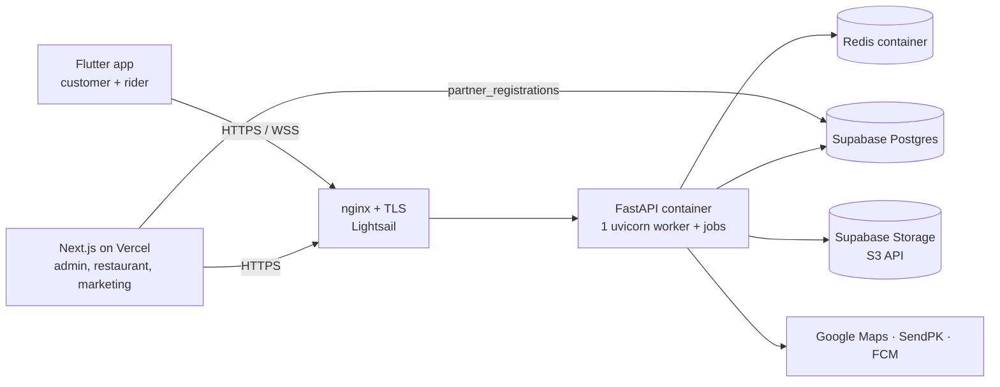

# SpeedyMeals — Technical Requirements Document (TRD) v2.0

| Field | Value |
|---|---|
| Version and status | 2.0, draft for review |
| Date | 2026-10-22 |
| Baseline | `main` (= production checkout). Structure: [`AGENT_MAP.md`](AGENT_MAP.md) |
| Supersedes | `docs/TRD_current.md` (v1.0, 19 Oct 2026). Per-claim corrections are in [`TRD_REVIEW.md`](TRD_REVIEW.md) |
| Owner | Project lead (Syed Ammar Ali) |
| Reviewers (to confirm) | Backend dev, website dev, mobile dev, DevOps engineer, QA |

**Conventions**
- MUST, SHOULD and MAY follow RFC 2119.
- **Status:**
  - **DONE**: implemented, with evidence in code.
  - **PARTIAL**: implemented with gaps.
  - **DEFECT**: implemented wrongly or insecurely.
  - **PLANNED**: not implemented. Every PLANNED item cites its source.
- **Priority:** P0 = launch blocker, P1 = launch readiness, P2 = scale and quality, P3 = ecosystem.
- **IDs:** v1 IDs are kept. New IDs (added in v2) are marked ★.
- **Evidence:** paths are relative to the repo root. `be/` = `backend/app/`, `web/` = `website/`, `mob/` = `mobile_app/`.
- **Evidence rule:** code is the source of truth. Anything not checkable in the repo is labelled *Assumption* (§17) or *Open question* (§18).

**What changed from v1:**
- Rider wallet rules are corrected: there is no Rs 500 minimum or recharge rule, and no auto-offline.
- The rider's 90% delivery share is a credit, not a deduction, and the per-rider rate is unused.
- Account deletion moves from PLANNED to PARTIAL.
- NFR-04 is fixed and NOT-03 is done.
- RLS/anon exposure is confirmed live.
- New defects are added: REST-07, SEC-18 to SEC-23.
- Fee distance comes from the Directions API, and discovery uses Haversine only.
- Counts and versions are refreshed.

## 1. Purpose
This TRD defines what the SpeedyMeals platform does today, how well, what is defective, and what is planned. It is the reference for developers, QA, DevOps and stakeholders deciding scope, budget and sequencing.

## 2. Scope
**In scope:**
- The FastAPI backend.
- The Next.js website (marketing, admin portal, restaurant portal).
- The Flutter app (customer and rider).
- The Supabase SQL assets.
- CI/CD and infrastructure.
- The roadmap: launch in Karachi, then Pakistan, then Saudi Arabia.

**Out of scope:** marketing content, legal texts (`docs/SpeedyMeals_Terms_of_Use.md`, privacy), financial modelling and detailed UI design.

## 3. Stakeholders and actors

| Stakeholder | Interest |
|---|---|
| Project lead / product owner | Scope, priorities, budget, business rules |
| Backend, website and mobile developers | Implementation |
| DevOps engineer (contract) | Infrastructure, CI/CD, observability, cost, migration (`docs/onboarding/DEVOPS_ONBOARDING.md`) |
| QA | Verification (`docs/onboarding/QA_ONBOARDING.md`) |
| Investors | Roadmap and risk (read-only) |

| System actor | Client | Auth |
|---|---|---|
| Customer | Flutter app | Phone OTP |
| Rider | Flutter app | Phone OTP; admin approval; kit |
| Restaurant staff | Web `/restaurant` | Email and password, or OTP |
| Admin and admin staff | Web `/admin` | Email and password; roles and permissions |

## 4. Definitions
- **COD:** cash on delivery.
- **Pending cash owed:** COD cash a rider collected that has not yet been approved as deposited.
- **Kit:** rider starter kit (deposit, ≥ 2 shirts, delivery box).
- **Sweeper:** in-process job that expires ignored rider offers and re-dispatches.
- **RLS:** Postgres Row Level Security.
- **Modular monolith:** one deployable backend with separated internal modules.

## 5. Business rules (verified in code)

| Rule | Value | Evidence |
|---|---|---|
| Delivery fee | `100 + 25 × km`. Route km from Google **Directions** (2 dp), Haversine fallback, cached 600 s. **No cap** | `be/modules/food_delivery/service.py:1520-1534,1605-1632` |
| Platform fee | Rs 15.00 per order, inside `total_amount` (not a column) | `service.py:1527` |
| GST | Per restaurant `gst_rate` 0–30%, inclusive or exclusive (`prices_include_gst`, default inclusive). Food only. ROUND_HALF_UP to paisa. Snapshot on the order | `be/modules/food_delivery/tax.py`; `models.py:39-40,93-96` |
| Customer total | food total after GST + delivery fee + 15 | `service.py:1637` |
| Restaurant commission | `net (ex-GST) food × commission_rate%`. Default 10. Frozen at placement | `service.py:1130,1795`; `models.py:29` |
| Restaurant payable | net − commission + GST | `service.py:1796` |
| Rider share | 90% of the delivery fee (`RIDER_DELIVERY_SHARE`), frozen as `rider_earning`, **credited** to the wallet on Delivered. The platform keeps 10%. `riders.commission_rate` exists but is **unused** | `be/platform/wallet_payment/service.py:56,142`; `admin/service.py:275` |
| COD accrual | On Delivered (COD): `pending_cash_owed += total_amount` | `service.py:1071` |
| COD cap | `CASH_COLLECTION_CAP` 5000. At or above it the rider is forced offline, can't go online, and is skipped for COD offers | `config.py:113`; `wallet_payment/service.py:131,187`; `service.py:643` |
| Go online | Needs `kit_completed` **and** cash owed under the cap. No wallet minimum | `wallet_payment/service.py:131` |
| Kit | Complete when deposit paid + ≥ 2 shirts + box issued. `KIT_DEPOSIT_AMOUNT` 5000. Serials tracked | `:50,451` |
| Wallet recharge | Any positive amount; methods `bank_transfer`, `jazzcash`, `easypaisa`, `card`. **Credited instantly with no payment proof** | `:97` |
| Low-wallet reminder | Push after a delivery when balance < Rs 100 | `order_notifications.py:137`; `wallet_payment/service.py:51` |
| Worked example | Food 1000, 16% exclusive, 4.2 km, 10%: total **1380.00**; commission 100; restaurant 1060; rider 184.50 | Computed with the real functions (QA_ONBOARDING §5) |

## 6. Functional requirements

### 6.1 Authentication and access (AUTH)
| ID | Requirement | Status | Evidence / gap |
|---|---|---|---|
| AUTH-01 | Customers MUST sign in by 6-digit phone OTP (5 min TTL, 45 s cooldown); account created on first verify | DONE | `be/platform/auth/service.py:37-38,103` |
| AUTH-02 | OTP MUST go through a live SMS gateway in production | PARTIAL (P0) | SendPK client exists (`sms_client.py`). Default `SMS_MODE=console`. Live prod value is an open question (Q5) |
| AUTH-03 | Riders MUST register by OTP and start `pending` | DONE | `/auth/rider/register`, `/auth/rider/login/otp-verify` |
| AUTH-04 | Restaurants MUST be admin-provisioned; login by password or OTP | DONE | `/admin/restaurants`, `/auth/restaurant/*` |
| AUTH-05 | Admins MUST log in by password; first admin seeded; forced change of temporary passwords | PARTIAL (P0) | Enforced from the token claim (`dependencies.py:111`), but bypassed after refresh (SEC-20) |
| AUTH-06 | Access 30 min; refresh 30 days, SHA-256 hashed, rotated, revoked on logout | DONE | `jwt_utils.py:13`; `service.py:184,297` |
| AUTH-07 | Admin and restaurant password reset by emailed link | PARTIAL (P1) | No email. The link is printed when `ENVIRONMENT != production`, which is prod's effective state (SEC-21) |
| AUTH-08 | Rate limit 5 per 60 s on OTP, login and forgot-password | DONE (fails open) | `be/core/rate_limiter.py:16`; `auth/routes.py` |
| AUTH-09 | No default or hardcoded credentials in any environment | DEFECT (P0) | Admin default password in `config.py:94`. Demo restaurant seeded when `ENVIRONMENT=development`. Website auto-login (`web/lib/api/client.ts:148,177`) |

### 6.2 Customer (CUS)
| ID | Requirement | Status | Evidence / gap |
|---|---|---|---|
| CUS-01 | Profile and address CRUD | DONE | `be/platform/users/routes.py` |
| CUS-02 | Discovery: active restaurants within a radius of the customer's address, name search, sort by distance or rating | DONE | `service.py:1215`. **Haversine distance only** (no road distance) |
| CUS-03 | Menu by category; sold-out visible but not orderable | DONE | Checkout rejects sold-out or removed items |
| CUS-04 | Per-restaurant carts in Redis (7 days), cleared only after the order commits | DONE | `service.py:1361,1386` |
| CUS-05 | Checkout preview and placement repriced from the DB; `Idempotency-Key` with 24 h replay; 409 on a price change | DONE | `routes.py:192-222`; `service.py:1656-1770` |
| CUS-06 | Order tracking (REST) and live rider location (WebSocket) | DONE | `routes.py:375,466`. Remaining hardening is in INT-05 and NFR-04 |
| CUS-07 | History, reorder, rating (Delivered only, once) | DONE | `service.py:1891,1970` |
| CUS-08 | Customer cancellation with refund rules | PLANNED (P1) | Source: TRD v1 §5.2 / FUT-06. Today only admin and restaurant can cancel |
| CUS-09 | In-app account deletion (store requirement) | PARTIAL (P0) | Backend and app done (§6.11). The public web page `/delete-account` is missing on `main`, while the app links to it |

### 6.3 Restaurant (REST)
| ID | Requirement | Status | Evidence / gap |
|---|---|---|---|
| REST-01 | Admin creates accounts, sets status and commission, resets credentials | DONE | `admin/routes.py:63-117` |
| REST-02 | Menu CRUD, variants, availability, photo upload (5 MB, JPG/PNG, magic bytes) | DONE | `service.py:116-140` |
| REST-03 | Order list and detail; advance status one step; reject only from `Accepted` | DONE | `routes.py:310-375`; `service.py:827,854` |
| REST-04 | Profile (prep time, GST settings), metrics, settlements | DONE | `routes.py:606-746` |
| REST-05 | Opening hours MUST be enforced at discovery and checkout | PLANNED (P1) | Source: TRD v1 / FUT-07. Hours are stored but not checked |
| REST-06 | Handling when the restaurant doesn't act within a timeout | PLANNED (P1) | Source: TRD v1 / FUT-07. Orders are created already `Accepted` |
| REST-07 ★ | A restaurant MUST only move orders through `Accepted → Preparing → Ready for Pickup` (or reject) | DEFECT (P0) | The shared `ORDER_STATUS_TRANSITIONS` lets restaurants set rider states and `Delivered`, skipping commission and COD accrual (`service.py:567,854`) |

### 6.4 Rider (RID)
| ID | Requirement | Status | Evidence / gap |
|---|---|---|---|
| RID-01 | KYC docs (CNIC, licence, vehicle) to private storage, validated, read by presigned URL | DONE | `/wallet/documents/{doc_type}`; `be/core/storage.py:186` |
| RID-02 | Admin approval and activation | DONE | `/admin/riders/{id}/approval`, `/status` |
| RID-03 | Kit handover with serials; `kit_completed` gates going online | DONE | `/admin/riders/{id}/kit` |
| RID-04 | Going online MUST require `kit_completed` and cash owed under the COD cap | DONE | `wallet_payment/service.py:131`. v1's "wallet ≥ 500 / auto-offline < 100" was never implemented. Whether it's wanted is Q2 |
| RID-05 | GPS push to Redis (45 s TTL) with pub/sub fan-out | DONE | `wallet_payment/service.py:397,415` |
| RID-06 | Nearest eligible rider (approved, active, online, fresh location, COD cap); 60 s offer timeout; 15 s sweeper; rejecting riders excluded | DONE | `service.py:595-717`; `config.py:108-109`. Linear scan over riders (DATA-09) |
| RID-07 | Accept or reject; dedicated delivery-step endpoints | DONE | `POST /wallet/assignments/{id}/respond`; `PATCH /wallet/deliveries/{id}/status/*` |
| RID-08 | Earnings summary, profile, assignments | DONE | `/wallet/earnings`, `/profile`, `/assignments` |

### 6.5 Wallet and cash (WAL)
| ID | Requirement | Status | Evidence / gap |
|---|---|---|---|
| WAL-01 | Every wallet movement MUST create a transaction record | DONE | `WalletTransaction` (recharge, earning) |
| WAL-02 | Recharge MUST credit only after gateway confirmation or admin approval | DEFECT (P0) | Any amount credited instantly (`:97`) |
| WAL-03 | Cash deposits stay unverified until admin approval; only approval reduces owed cash; no double approval | DONE | `:241,279` |
| WAL-04 | COD cap blocks COD offers at 5000 owed; digital unaffected | DONE | `service.py:643` |
| WAL-05 | Status change, wallet credit and COD accrual commit atomically under row locks | DONE | `service.py:1040-1080` |
| WAL-06 | Money MUST be Decimal end to end | PARTIAL (P1) | Float conversions in the wallet, COD and deletion code |
| WAL-07 ★ | Rider remuneration MUST be paid exactly once | DEFECT? (P0, decision) | The wallet is credited 90% **and** `rider_payouts` sums the same `rider_earning` (`admin/service.py:602`). Q1 |

### 6.6 Admin and RBAC (ADM)
| ID | Requirement | Status | Evidence / gap |
|---|---|---|---|
| ADM-01 | Dashboard and reports | DONE | `/admin/dashboard`, `/reports` |
| ADM-02 | Manage restaurants, riders, customers; cancel (any non-terminal) and reassign (approved and active rider) orders | DONE | `admin/service.py:393,413` |
| ADM-03 | Settlements and rider payouts: generate, mark paid (status only; no payout rail) | DONE | `admin/service.py:468,602` |
| ADM-04 | Cash discrepancy review and deposit approval | DONE | `/admin/cash-discrepancies` |
| ADM-05 | Promotions persisted and applied at checkout | DEFECT (P1) | In-memory list (`admin/service.py:891`), never applied |
| ADM-06 | Dynamic roles, permissions, staff, audit log | DONE | `modules/admin_roles`, `modules/admin_accounts` |
| ADM-07 | Every admin route MUST check a permission key | PARTIAL (P0) | Only roles and accounts, rider commission and deletion requests use `require_permission`. The rest are role-only (`admin/routes.py:48`) |
| ADM-08 | Audit log MUST cover money actions | PLANNED (P1) | Source: TRD v1. No audit writes in `admin/service.py` or `wallet_payment/service.py` |

### 6.7 Notifications, location, payments (NOT, LOC, PAY)
| ID | Requirement | Status | Evidence / gap |
|---|---|---|---|
| NOT-01 | Device token register and remove | DONE | `/devices` |
| NOT-02 | FCM push for order events; no-op without credentials | DONE | `order_notifications.py`. End-to-end device delivery untested (AGENT_MAP §4) |
| NOT-03 | Low-wallet reminder push | DONE | `order_notifications.py:137` (< Rs 100, after each delivery) |
| LOC-01 | Geocode and Places proxy; daily budget (default 300); caching | DONE | `be/platform/location/`; `config.py:54` |
| LOC-02 | Pickup and drop coordinates snapshotted on orders | DONE | Migration `e7f8a9b0c1d2` |
| PAY-01 | Cash on delivery | DONE | — |
| PAY-02 | Digital payment through a real gateway with webhooks | PLANNED (P0/P1) | Source: TRD v1 / FUT-05. Stub `STUB-DIGITAL-…` (`service.py:1702`), disabled by `ONLINE_PAYMENTS_ENABLED=false` |
| PAY-03 | Refunds on cancellation or failure | PLANNED (P1) | Source: TRD v1 / FUT-06 |

### 6.8 Website and mobile (WEB, MOB)
| ID | Requirement | Status | Evidence / gap |
|---|---|---|---|
| WEB-01 | Marketing site incl. partner registration | DONE | Writes to Supabase `partner_registrations` directly (`web/app/api/register/route.ts`) |
| WEB-02 | Admin portal pages | DONE | `web/app/admin/*`. Missing: deletion-requests page |
| WEB-03 | Restaurant portal pages | DONE | `web/app/restaurant/*` |
| WEB-04 | Route protection MUST verify a signed session server-side | DEFECT (P0) | `web/proxy.ts` checks cookie values only |
| WEB-05 | Automated website tests | PLANNED (P1) | Source: TRD v1. No test script |
| WEB-06 ★ | Public account-deletion page at the URL the app links to | DEFECT (P0, store) | `mob/lib/core/constants/app_constants.dart:54` → 404 on `main`. A draft exists on branch `account-deletion`; it must be ported to `main`'s API (AGENT_MAP §1) |
| MOB-01 | Customer flows | DONE | `mob/lib/screens/**` |
| MOB-02 | Rider flows incl. background location | DONE | `rider_location_service.dart` |
| MOB-03 | FCM push in app | DONE | `mob/lib/services/push_service.dart` |
| MOB-04 | Separate restaurant app | PLANNED (P3) | Source: TRD v1 |

### 6.9 Order lifecycle (reference)
`Accepted` (on checkout) → `Preparing` → `Ready for Pickup` → (auto) `Rider Assigned` → `Accepted by Rider` | `Rejected` → re-dispatch → `Arrived at Restaurant` → `Picked Up` → `On the Way` → `Delivered`.
- **Restaurants:** reject (`Accepted` → `Cancelled`) or cancel up to `Ready for Pickup`.
- **Admin:** cancel any non-terminal order.
- `Delivered` and `Cancelled` are terminal (`service.py:567`; `admin/service.py:390`).

### 6.10 Data and interface requirements (DATA, INT) carried from v1
| ID | Requirement | Status |
|---|---|---|
| DATA-01 | Alembic is the only path for backend tables. **`partner_registrations` lives only in `supabase/migrations/`** | PARTIAL (P1) |
| DATA-02 | Migrations run once per release as a dedicated step (today in CMD and CI) | DEFECT (P1) |
| DATA-03 | Migration discipline (one author, review, no direct prod edits) | PLANNED (P1). Source: TRD v1. The 20–22 Oct outage shows why |
| DATA-04 | Money columns fixed precision (today unconstrained `Numeric`) | PLANNED (P1) |
| DATA-05 | Country and currency on records before the Gulf launch (columns exist on restaurants and riders) | PARTIAL (P2) |
| DATA-06 | Retention: anonymised orders 6 years (assumption, counsel); KYC minimal | PLANNED (P1). Source: TRD v1 §13.5 owner policy |
| DATA-07 | Automated backups with a tested restore | PLANNED (P0). Supabase Free has no restorable backups |
| DATA-08 | Minimal grants for `anon`/`authenticated`; RLS policies | DEFECT (P0). Live: ALL on 24 tables; the 6 Oct migration re-granted anon |
| DATA-09 | Indexed rider search (Redis GEO or PostGIS) | PLANNED (P2) |
| INT-01 | Version the API under `/api/v1` before public mobile release (only location is versioned) | PLANNED (P1) |
| INT-02 | One error envelope | PLANNED (P1) |
| INT-03 | Idempotency keys on money POSTs (checkout has one) | PARTIAL (P1) |
| INT-04 | Pagination on all lists | PLANNED (P2) |
| INT-05 | WebSocket auth by short-lived ticket, not a JWT in the URL | PLANNED (P1). Proposal: `docs/websocket-token-proposal.md` |
| INT-06 | OpenAPI as the contract; generated clients | PLANNED (P2) |

### 6.11 Account deletion (as built, CUS-09 / FUT-04)
| Aspect | Implementation | Evidence |
|---|---|---|
| Customer | `DELETE /users/me`: immediate anonymisation if no active order, else 409. Tokens revoked and denylisted, device tokens deleted, carts purged | `be/platform/account_deletion/service.py:376-430` |
| Rider | Request → deactivated, 7-day grace (`RIDER_DELETION_GRACE_DAYS`), cancellable. 409 during an active delivery. Completion blocked while wallet or cash owed ≠ 0 | `service.py:236-345`; `config.py:135` |
| Admin | Review queue `/admin/deletion-requests` (approve, hold, release), permission `manage_deletion_requests`. Overdue after 30 days (`DELETION_REQUEST_OVERDUE_DAYS`). Early approval behind a flag | `routes.py`; `config.py:139-142` |
| Public web flow | `POST /account-deletion/request`, `/confirm` (rate limited) | `routes.py` |
| Job | Hourly deletion review job, Redis-locked | `be/core/deletion_review_job.py` |
| Gaps | Web page (WEB-06), admin UI page, 15-day review target in v1 vs 30-day overdue in code (Q8), KYC object deletion (Q8) | — |

## 7. Non-functional requirements
"Proposed" targets come from TRD v1 and are not yet agreed (Q10).

| ID | Area | Requirement | Status |
|---|---|---|---|
| NFR-01 | Performance | p95 ≤ 300 ms reads, ≤ 500 ms writes, excluding Maps (proposed) | Unmeasured |
| NFR-02 | Capacity | Pilot ≥ 100 online riders, 1,000 concurrent customers (proposed) | Unmeasured |
| NFR-03 | Availability | 99.5% pilot, 99.9% after load balancing (proposed) | PLANNED |
| NFR-04 | Real-time | The tracking loop MUST NOT block the event loop | DONE (`asyncio.to_thread`). Open: a DB poll every ~0.5–1.5 s per socket, no heartbeat |
| NFR-05 | Scalability | Stateless API behind a load balancer; shared state only in Postgres and Redis | PARTIAL: the in-memory Redis fallback breaks multi-instance correctness (SEC-12) |
| NFR-06 | Reliability | Background jobs safe with N instances | DONE with shared Redis (`SET NX` locks + `SKIP LOCKED`) |
| NFR-07 | Observability | §14 | PLANNED |
| NFR-08 | Cost | Budgets and alerts; staged cost estimate | PLANNED (DevOps deliverable) |
| NFR-09 | Deployability | CI tests, build, deploy, smoke test, rollback | PARTIAL (deploy only) |
| NFR-10 | Accessibility and UX | WCAG 2.1 AA; full screen states | PARTIAL (Source: TRD v1) |
| NFR-11 | Localisation | Urdu and Arabic with RTL | PLANNED (P2). Source: `docs/urdu_arabic.md` |
| NFR-12 | Browser support | Chrome and Edge 109+, Safari 16+, Firefox 109+ | DONE (`web/package.json` browserslist) |
| NFR-13 | Compliance | PTA SMS rules, store account deletion, GST, PK and KSA data protection | PARTIAL |
| NFR-14 | Maintainability | Lint, typecheck and tests in CI for all three apps | PLANNED (P1) |

## 8. Architecture
- **Style:** modular monolith (FastAPI). Platform modules (`auth`, `users`, `wallet_payment`, `location`, `notification`, `account_deletion`) serve business modules (`food_delivery`, `admin`, `admin_roles`, `admin_accounts`). `ride_hailing`, `logistics` and `medicine` are empty placeholders.
- **Request path:** thin route → role or permission dependency → Pydantic → service → SQLAlchemy. Ownership is in WHERE clauses (404, not 403).
- **In-process jobs:** assignment sweeper (15 s) and deletion review job (1 h), both Redis-locked.

| Layer | Technology (pinned in repo) |
|---|---|
| Backend | Python 3.11 (`python:3.11-slim`), FastAPI 0.115.0, Uvicorn 0.30.6, SQLAlchemy 2.0.35, Alembic 1.13.2, Pydantic 2.9.2, python-jose 3.3.0, passlib 1.7.4, redis 5.0.8, boto3 1.35.24, httpx 0.27.2, firebase-admin 6.5.0 |
| Website | Next.js ^16.3.4, React ^19.0.1, Tailwind ^4.1.14, TypeScript ~5.8.2, motion ^13.2.0, firebase ^13.0.0, supabase-js ^2.116.0, Bun 1.3.14 |
| Mobile | Flutter, Dart ^3.13.2 |
| Size | Backend: 14.9k lines (non-test, non-migration), 126 HTTP routes + 1 WS, 17 Alembic revisions, 506 test functions (30 files). Mobile: 12 test files. Website: 0 tests |

## 9. Data model
Schema source: Alembic plus the SQLAlchemy models. Supabase SQL holds the grant and RLS history, plus `partner_registrations`.

| Table(s) | Purpose / key attributes |
|---|---|
| `users`, `addresses` | Customers (phone unique); delivery addresses with lat/lng |
| `restaurants`, `menu_items` | `commission_rate` (default 10), `gst_rate`, `prices_include_gst`, `prep_time_minutes`, `status`, hours, lat/lng; menu with variants and availability |
| `riders` | Approval, `wallet_balance`, `pending_cash_owed`, `is_online`, kit fields and serials, `commission_rate` (unused) |
| `orders`, `order_items` | Status, payment method, frozen `food_subtotal`, `delivery_fee`, `total_amount`, `commission_amount`, `restaurant_payable`, `rider_earning`, GST snapshot, location snapshots, `rider_assigned_at`, cancellation fields |
| `ratings` | Restaurant and rider rating per order |
| `wallet_transactions`, `cash_deposits` | Wallet audit trail; COD deposits (expected, discrepancy, verified) |
| `settlements`, `rider_payouts` | Period payouts (manual mark-paid) |
| `admins`, `admin_roles`, `permissions`, `admin_audit_logs`, `password_reset_tokens` | Back office and RBAC |
| `refresh_tokens`, `device_tokens` | Hashed refresh tokens; FCM tokens |
| `deletion_requests` | Account deletion workflow (head `d4a7c9e1f2b3`) |
| `partner_registrations` | Website partner leads (**Supabase SQL only**) |
| *Unused leftovers* | `account_deletion_*`, `users.deleted_at`, `riders.deleted_at`, `riders.deletion_requested_at` (draft migration run against prod) |

Money columns are unconstrained `Numeric` (DATA-04). The only extension is `pgcrypto`.

## 10. API summary
REST and JSON over HTTPS, Bearer JWT. OpenAPI at `/docs` (public, SEC-09).

| Group | Prefix | Access |
|---|---|---|
| Auth | `/auth` | Public / any role |
| Users and deletion | `/users/me*`, `/account-deletion/*` | Customer / public |
| Location | `/api/v1/location/*` | Authenticated |
| Devices | `/devices` | Authenticated |
| Rider | `/wallet/*` (balance, status, recharge, cash deposit, cod-eligibility, earnings, location, documents, profile, assignments, deliveries) | Rider |
| Customer browse, cart, checkout | `/restaurants`, `/restaurants/{id}/menu`, `/restaurants/{id}/cart*` | Customer |
| Customer orders | `/orders`, `/orders/{id}/track` (REST + WS), `/reorder`, `/rating` | Customer |
| Restaurant portal | `/restaurants/me/{menu-items,orders,profile,metrics,settlements}` | Restaurant |
| Admin | `/admin/*` (dashboard, restaurants, riders, orders, settlements, rider-payouts, cash-discrepancies, reports, customers, promotions, deletion-requests) | Admin (mostly role-only) |
| Admin RBAC | `/admin/roles`, `/admin/accounts` | Admin + permission |
| System | `/health` | Public |

WebSocket `/orders/{id}/track?token=`: events `location_update` and `order_completed`; a bad token gets `auth_failed` and close 4003.

## 11. Integrations
| System | Use | Status |
|---|---|---|
| Google Maps Platform | Directions (fee and route), Distance Matrix, Geocode, Places | DONE. Daily budget counter in Redis |
| SendPK | OTP SMS | DONE (client). Live mode, PTA sender and template: Q5 |
| Firebase Cloud Messaging | App and web push | DONE. Prod key verified by dry run only |
| Supabase | Postgres, Storage, website direct writes | Live. Free plan **over quota; restriction from 18 Nov 2026** |
| AWS S3 | Target storage | Code path exists (`storage.py`); not in use |
| Payment gateway | Digital orders, recharge, refunds | Not integrated (PAY-02) |

## 12. Security requirements
**In place:** JWT with rotation and revoke; bcrypt; ownership in queries; Redis rate limits; upload validation; private rider docs with presigned URLs; env-driven CORS; backend security headers (nosniff, referrer, HSTS, no-store on auth and wallet paths).

| ID | Finding / requirement | Priority |
|---|---|---|
| SEC-01 | Wallet recharge credits without payment (WAL-02) | P0 |
| SEC-02 | Default and demo credentials (AUTH-09); rotate anything that used them | P0 |
| SEC-03 | Website session: unsigned cookies, tokens in localStorage → HttpOnly cookies + JWT verification (WEB-04) | P0 |
| SEC-04 | Permission keys missing on most admin routes (ADM-07) | P0 |
| SEC-05 | Secrets in logs or responses: reset links printed (non-prod mode); console OTP printed; temporary admin password returned in the API response | P1 |
| SEC-06 | WS token in the query string reaches access logs (INT-05) | P1 |
| SEC-07 | CORS regex allows `speedymeals-*.vercel.app` with credentials (`be/main.py:96`) | P1 |
| SEC-08 | Rate limiter fails open | P1 |
| SEC-09 | `/docs` public in production | P1 |
| SEC-10 | Container runs as root; migrations at start | P1 |
| SEC-11 | Repo compose publishes 5432 and 6379. On the server they're closed (see SEC-22) | P1 |
| SEC-12 | Redis silently falls back to memory → MUST fail fast and alert | P1 |
| SEC-13 | Past anon exposure: review logs, rotate keys, force admin resets. **Exposure is still live** (DATA-08) | P0 |
| SEC-14 | Single HS256 secret, no rotation | P2 |
| SEC-15 | KYC encryption at rest, access logging | P2 |
| SEC-16 | Dependency and secret scanning in CI | P1 |
| SEC-17 | Website security headers and CSP. Only `Cache-Control` is set (`web/next.config.ts:82`) | P1 |
| SEC-18 ★ | Cross-tenant fallback: `_resolve_restaurant_id` returns the first restaurant (`food_delivery/routes.py:228`) | P0 |
| SEC-19 ★ | Restaurant password login ignores `status`. Restaurant and admin `is_active` not checked per request | P1 |
| SEC-20 ★ | Refresh drops `permissions` and `must_change_password` (`auth/service.py:344`) | P0 |
| SEC-21 ★ | Production MUST set `ENVIRONMENT=production` (today unset → demo seed, reset links logged) | P0 |
| SEC-22 ★ | Port 8000 is publicly open on Lightsail, bypassing nginx and TLS | P1 |
| SEC-23 ★ | Website writes to Supabase with a service-role key (`web/app/api/register/route.ts`) | P1 |

## 13. Deployment and infrastructure
**Current (owner-confirmed, AGENT_MAP §4):**
- **Backend:** AWS Lightsail $12 (Ubuntu), Docker `api` (1 worker) plus Redis bound to localhost, nginx and Certbot in front.
- **DB:** Supabase Free.
- **Website:** Vercel.
- **Mobile:** built manually.
- **Secrets:** `.env` files on the server.
- **Deploy:** `.github/workflows/deploy-backend.yaml` on push to `main` (`backend/**`): SSH → `git pull` → `docker compose up -d --build api redis` → `alembic upgrade head`. No test gate, no health check, no rollback.
- **Health:** `GET /health` (static) and `backend/scripts/healthcheck.sh` (manual).

| ID | Requirement | Priority | Status |
|---|---|---|---|
| INF-01 | Observability (§14) | P1 | PLANNED |
| INF-02 | Cost monitoring; staged estimate (no AWS budget yet) | P1 | PLANNED |
| INF-03 | CI/CD: tests on Postgres and Redis service containers, image build, registry, gated deploy, single migration step, smoke test, rollback; website and mobile CI | P0 | PLANNED |
| INF-04 | ALB with TLS, ≥ 2 instances, readiness health check, WebSocket support (no sticky sessions needed with shared Redis), autoscaling | P1 | PLANNED |
| INF-05 | Supabase → Aurora/RDS plan and rehearsal; Storage → S3 with URL rewrite; port `partner_registrations` | P2 (prepare now) | PLANNED |
| INF-06 | Separate dev, staging and prod (DB, secrets, keys). **Dev tools have hit prod (20–22 Oct outage)** | P0 | PLANNED |
| INF-07 | Secrets manager and rotation | P0 | PLANNED |
| INF-08 | Managed Redis with auth; fail loudly | P1 | PLANNED |
| INF-09 | Container hardening | P1 | PLANNED |
| INF-10 | Edge protection and WAF | P1 | PLANNED |
| INF-11 | Backup and restore drills | P0 | PLANNED |
| INF-12 | Decision: monolith vs split (ADR) | P1 | Open (Q11) |

Details: `docs/onboarding/DEVOPS_ONBOARDING.md`.

## 14. Observability
Today the platform has application logs only (Docker), a static `/health`, the manual `healthcheck.sh`, and startup banners (SMS mode). There is no metrics, error tracking, uptime or alerting.

Required (INF-01, PLANNED):
- structured logs with token and phone scrubbing
- latency, 5xx, DB pool and Redis metrics
- **Redis fallback events**
- sweeper results
- unassigned and `Ready for Pickup` age
- orders per minute
- OTP, SMS, Maps and FCM failure rates
- Maps budget usage
- settlement and payout job runs
- uptime checks
- alert routing

Testing and quality (QA-01..09 from v1) remain as written. QA-01 (pytest gating deploys) is P0. Current state: `docs/onboarding/QA_ONBOARDING.md` §6.

## 15. Risks
| ID | Risk | L / I | Mitigation |
|---|---|---|---|
| R-01 | Wallet or cash fraud (free recharge) | High / High | WAL-02 first; COD cap stays on |
| R-02 | Personal data reachable via the anon key (still granted) | Medium / High | DATA-08, SEC-13 |
| R-03 | DevOps scope too large for 1–2 weeks | High / Medium | Cost estimate → backups → CI gate first |
| R-04 | PTA sender approval delays live OTP | Medium / High | Q5 |
| R-05 | Payment gateway onboarding slow | High / High | COD-only pilot with gated recharge |
| R-06 | Single instance; in-process jobs | Medium / High | INF-04 |
| R-07 | Maps cost growth | Medium / Medium | Budget counter + alerts |
| R-08 | Small junior team | High / Medium | Phase scope, review, CI |
| R-09 | Documentation drift | High / Medium | Code-first docs (this TRD, AGENT_MAP) |
| R-10 | Aurora cutover data loss | Low / High | Rehearsal, rollback |
| R-11 | Retention vs local law | Medium / Medium | Counsel review |
| R-12 ★ | Supabase Free over quota; restriction from 18 Nov 2026; no restorable backups | High / High | Pro upgrade (requested), immediate `pg_dump` |
| R-13 ★ | Migrations from dev machines against prod (happened 20–22 Oct) | Medium / High | INF-06, DATA-02/03 |
| R-14 ★ | Play Store rejection: deletion URL 404 | High / High | WEB-06 |

## 16. Roadmap and future features (all PLANNED; source: TRD v1 §13 unless noted)
| Phase | IDs | Items |
|---|---|---|
| 0: before any real user | FUT-01, FUT-02, FUT-03, FUT-03b, FUT-03c, **+ REST-07, SEC-18, SEC-20, SEC-21, WEB-06** | Gate recharge; credential hygiene; website session security; RBAC on all admin routes; DB exposure review; plus the v2 P0 defects |
| 1: launch readiness | FUT-04 (now PARTIAL), FUT-05 to FUT-14, FUT-15 (low-wallet push done; no auto-offline exists) | Deletion completion, payment gateway, cancellation and refunds, hours and timeouts, promotions engine, WS hardening (ticket, no DB poll), email, Decimal money, fee model completion (first-month waiver; decide on per-rider `commission_rate`), API versioning and errors, SMS failover |
| 2: scale and quality | FUT-20 to FUT-28 | AWS target platform, dispatch v2, automated finance, multi-staff restaurants, localisation, customer growth, pricing controls, pagination and caching, security maturity |
| 3: ecosystem | FUT-30 to FUT-34 | Platform extraction, Speedy Drive, courier, multi-city and multi-country, SpeedyPay and B2B. Order as approved by the owner in TRD v1 §13.4 |

## 17. Assumptions
- Production values not in the repo are as reported in AGENT_MAP §4 (owner-confirmed 2026-10-22): Lightsail, Supabase Free, Vercel, `ENVIRONMENT` unset, Redis in Docker.
- The pilot is COD-only until PAY-02 ships, so `ONLINE_PAYMENTS_ENABLED` stays false.
- Load and availability targets in §7 are proposals from v1, not commitments.
- The 6-year anonymised retention is an assumption pending counsel (TRD v1).
- Team composition and the funding situation are as stated in TRD v1 §2.4 (not verifiable in the repo).

## 18. Open questions for the project lead
1. **Rider pay (WAL-07):** is the 90% wallet credit the rider's pay, or are `rider_payouts` paid on top? If both, riders are paid twice.
2. **Rider wallet rules (RID-04):** v1 described a Rs 500 first recharge, Rs 500 minimum to go online and auto-offline below Rs 100. None exist in code. Are they wanted, or is "kit + COD cap" the intended rule?
3. **Per-rider commission:** `riders.commission_rate` can be set by admins but is ignored (fixed 90/10). Should delivery use it?
4. **Wallet recharge (WAL-02):** until a gateway exists, should recharges become pending until an admin confirms them (like cash deposits)?
5. **SMS (AUTH-02):** is production on `SMS_MODE=sendpk` with an approved PTA sender ID and template today?
6. **Customer cancellation (CUS-08):** what rule (until restaurant prep? fee?) and refund policy?
7. **Opening hours and restaurant timeout (REST-05/06):** enforce at discovery and checkout? What timeout and action?
8. **Account deletion:** is the review target 15 days (v1 policy) or 30 days (code)? Must KYC images be deleted from storage on completion? Who ports the website page from branch `account-deletion`, and by when?
9. **First-month commission waiver:** still planned for riders and restaurants? From which date?
10. **Targets:** confirm or replace the proposed NFR-01..03 and RPO/RTO values.
11. **Architecture (INF-12):** keep the monolith for the pilot (v1 recommendation) or split?
12. **Supabase:** has the Pro upgrade happened before the 18 Nov 2026 restriction? Who owns the Supabase org?
13. **Mobile release URL:** which `API_BASE_URL` do release APKs use (this decides closing port 8000)?
14. **Promotions (ADM-05):** keep the UI hidden until a DB-backed engine exists, or build FUT-08 for launch?
15. **Settlement periods:** should overlapping settlement and payout periods be blocked?
16. **Leftover draft tables and columns in prod:** drop them or keep them?

## Appendix A. Backend environment variables (names only)
Required: `DATABASE_URL`, `JWT_SECRET`, `REDIS_URL`, `AWS_ACCESS_KEY_ID`, `AWS_SECRET_ACCESS_KEY`, `GOOGLE_MAPS_API_KEY`.
Optional (defaults in `be/core/config.py`):
- **Core:** `ENVIRONMENT` (development), `JWT_ALGORITHM` (HS256), `JWT_EXPIRE_MINUTES` (30).
- **Storage:** `AWS_REGION` (us-east-1), `S3_BUCKET_NAME` (speedymeals-docs), `S3_ENDPOINT_URL`, `SUPABASE_URL`, `SUPABASE_STORAGE_URL`.
- **Maps:** `GOOGLE_PLACES_API_KEY`, `MAPS_DAILY_CALL_BUDGET` (300).
- **Web and seeding:** `ALLOWED_ORIGINS`, `FIRST_ADMIN_EMAIL`, `FIRST_ADMIN_PASSWORD`.
- **Push:** `FIREBASE_CREDENTIALS_JSON`, `FIREBASE_CREDENTIALS_PATH`, `WEB_PUSH_BASE_URL`.
- **Dispatch:** `RIDER_ASSIGNMENT_TIMEOUT_SECONDS` (60), `ASSIGNMENT_SWEEPER_INTERVAL_SECONDS` (15), `ASSIGNMENT_SWEEPER_ENABLED` (true), `CASH_COLLECTION_CAP` (5000).
- **Payments:** `ONLINE_PAYMENTS_ENABLED` (false).
- **Deletion:** `RIDER_DELETION_GRACE_DAYS` (7), `ALLOW_EARLY_ADMIN_APPROVAL` (false), `DELETION_REQUEST_OVERDUE_DAYS` (30), `DELETION_REVIEW_JOB_ENABLED` (true), `DELETION_REVIEW_JOB_INTERVAL_SECONDS` (3600).
- **SMS:** `SMS_MODE` (console), `SENDPK_API_URL`, `SENDPK_API_KEY`, `SENDPK_SENDER_ID`, `SENDPK_TEMPLATE_ID`, `OTP_TEMPLATE`.

Website, mobile and CI names: `docs/onboarding/DEVOPS_ONBOARDING.md` §3.

## Appendix B. Key constants
| Constant | Value | Location |
|---|---|---|
| `DELIVERY_FEE_BASE`, `DELIVERY_FEE_PER_KM` | 100, 25 | `food_delivery/service.py:1520` |
| `PLATFORM_FEE` | 15.00 | `food_delivery/service.py:1527` |
| `DELIVERY_COMMISSION_RATE`, `RIDER_DELIVERY_SHARE` | 0.10, 0.90 | `wallet_payment/service.py:55-56` |
| `KIT_DEPOSIT_AMOUNT` | 5000 | `wallet_payment/service.py:50` |
| `WALLET_REMINDER_THRESHOLD` | 100 (also defined as 2000 at `:36`, overridden) | `wallet_payment/service.py:51` |
| `LOCATION_TTL_SECONDS` | 45 | `wallet_payment/service.py:79` |
| `MAX_GST_RATE` | 30 | `food_delivery/tax.py` |
| `OTP_EXPIRY_SECONDS`, `RESEND_COOLDOWN_SECONDS` | 300, 45 | `auth/service.py:37-38` |
| `REFRESH_TOKEN_EXPIRE_DAYS` | 30 | `auth/jwt_utils.py:13` |
| `VALID_RECHARGE_METHODS` / `VALID_DEPOSIT_METHODS` | bank_transfer, jazzcash, easypaisa, card / bank_transfer, mobile_wallet, hub | `wallet_payment/service.py` |

## Appendix C. Redis keys and channels
`otp:{phone}` (300 s), `otp:cooldown:{phone}` (45 s), `rate_limit:{action}:{id}` (60 s), `cart:{customer}:{restaurant}` (7 d), `idempotency:{customer}:{key}` (24 h), `checkout_dist:{restaurant}:{address}` (600 s), `rider_location:{rider}` (45 s), `order_excluded_riders:{order}`, `maps:daily_usage:{date}` (24 h), `assignment_sweeper_lock`, `deletion_review_job_lock`, plus location and places caches; pub/sub `order:location:{order}`.
