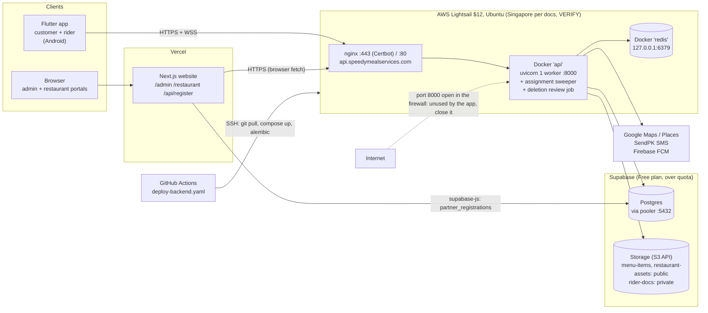

# DevOps Onboarding — SpeedyMeals

For: the newly hired DevOps engineer (1–2 week contract). Reports to the project lead, **Syed Ammar Ali**.
Verified against `main` on 2026-10-22: code, Dockerfiles, compose files, `.github/workflows/`, `supabase/migrations/`, `docs/`.
Repo map: [`docs/AGENT_MAP.md`](../AGENT_MAP.md). All paths are relative to the repo root (`speedymeals/`).

> **The code is the source of truth.** Most of `docs/` (MVP spec, blueprints, plans) describes the vision and is often outdated. When a doc and the code disagree, trust the code.
> Items marked **VERIFY** are reported but not confirmed in code. Items marked **ASK** need an answer from the project lead.
> **This document holds no secret values, and none may ever be added.**

## 1. Context

- SpeedyMeals is a food-delivery marketplace (customers, riders, restaurants, admin back office). It launches in **Karachi, Pakistan** and expands to **Saudi Arabia**. Later verticals (ride hailing, logistics, medicine) exist only as empty module folders.
- There is **no staging environment** and **no AWS budget allocated**. Your **first deliverable is a staged cost estimate** (§10).
- Load targets (users, orders per day, peak orders per minute) and RPO/RTO are **not defined**. Propose them; we confirm.
- Under consideration: keep the modular monolith or split the backend per role. We'd like your recommendation on operating cost and scale.

## 2. Current architecture

### 2.1 Services and where they run

| Service | Tech | Runs where | Deployed by | Notes |
|---|---|---|---|---|
| Backend API | FastAPI, Python 3.11, SQLAlchemy, Alembic | Lightsail, Docker container `api` (`backend/Dockerfile`, `backend/docker-compose.yml`) | GitHub Actions over SSH | 1 uvicorn worker; CMD runs `alembic upgrade head` **before** uvicorn |
| Reverse proxy and TLS | nginx + Certbot | Lightsail host (not in repo) | manual | `proxy_pass http://127.0.0.1:8000` (AGENT_MAP §4) |
| Redis | redis:7 | Lightsail, Docker, bound to `127.0.0.1:6379` | same compose | No persistence or backup config in repo |
| Background jobs | asyncio tasks **inside the API process** | same container | — | Assignment sweeper (`core/assignment_sweeper.py`) and deletion review job (`core/deletion_review_job.py`) |
| Database | Postgres | Supabase (pooler host, port 5432) | Alembic (`backend/app/migrations/versions/`, 17 revisions) | RLS and grant history in `supabase/migrations/` |
| File storage | Supabase Storage via the S3 API | Supabase | — | Selected by `S3_ENDPOINT_URL` (`backend/app/core/storage.py`) |
| Website | Next.js 16, Bun | Vercel (Git integration) | Vercel | `website/Dockerfile` exists (standalone build) but is unused in prod |
| Mobile | Flutter | Play Store (Android) | built manually by the mobile dev | Release builds use `flutter build apk --dart-define=API_BASE_URL=https://…`: HTTPS on 443 via nginx, **no `:8000`** (owner-confirmed 2026-10-23). **ASK** the mobile dev for the exact host string |
| Maps | Google Directions, Distance Matrix, Geocode, Places | external | — | Daily call budget counter in Redis (`MAPS_DAILY_CALL_BUDGET`) |
| SMS / OTP | SendPK | external | — | `SMS_MODE=console` (log only) or `sendpk` |
| Push | Firebase Cloud Messaging | external | — | Service-account JSON file on the server (`FIREBASE_CREDENTIALS_PATH`) |
| CI/CD | GitHub Actions | GitHub | — | Only one workflow: `.github/workflows/deploy-backend.yaml` |

Firewall (AGENT_MAP §4): open 22, 80, 443 **and 8000 (public, but no client needs it: close it, Task 4)**; closed 5432 and 6379.
Root `docker-compose.yml` and `README.md` are **0 bytes**. The real compose file is `backend/docker-compose.yml`.

## 3. Environment variables and secret ownership

Names only. Owners are **proposed**; the project lead confirms (**ASK**). Today every backend secret lives in plain `.env` files on the Lightsail host (`backend/.env` and `backend/app/.env`; the later file wins, see `backend/app/core/config.py`). `backend/app/.env.example` is missing about 15 of these names.

### Backend (`backend/app/core/config.py`)
| Name | Secret? | Proposed owner | Notes |
|---|---|---|---|
| `ENVIRONMENT` | no | DevOps | Default `development`. **Prod does not set it**, so prod runs as development: demo restaurant seeded, reset links logged |
| `DATABASE_URL` | **yes** (password) | Project lead | Supabase pooler today |
| `JWT_SECRET`, `JWT_ALGORITHM`, `JWT_EXPIRE_MINUTES` | secret / no / no | Project lead | HS256. Rotating the secret logs everyone out |
| `REDIS_URL` | no (no auth today) | DevOps | Host must be `redis` inside compose |
| `AWS_ACCESS_KEY_ID`, `AWS_SECRET_ACCESS_KEY`, `AWS_REGION`, `S3_BUCKET_NAME`, `S3_ENDPOINT_URL` | **yes** / **yes** / no / no / no | Project lead | Currently Supabase Storage S3 keys (**VERIFY**) |
| `SUPABASE_URL`, `SUPABASE_STORAGE_URL` | no | Project lead | Used to build public object URLs |
| `GOOGLE_MAPS_API_KEY`, `GOOGLE_PLACES_API_KEY`, `MAPS_DAILY_CALL_BUDGET` | **yes** / **yes** / no | Project lead | Cost driver; restrict keys by IP/API |
| `ALLOWED_ORIGINS` | no | DevOps | CORS |
| `FIRST_ADMIN_EMAIL`, `FIRST_ADMIN_PASSWORD` | no / **yes** | Project lead | Password defaults to a weak value in code. Must be rotated |
| `FIREBASE_CREDENTIALS_JSON`, `FIREBASE_CREDENTIALS_PATH`, `WEB_PUSH_BASE_URL` | **yes** / no / no | Project lead | Key file for project `speedymeals-84af9` |
| `SMS_MODE`, `SENDPK_API_URL`, `SENDPK_API_KEY`, `SENDPK_SENDER_ID`, `SENDPK_TEMPLATE_ID`, `OTP_TEMPLATE` | `SENDPK_API_KEY` **yes** | Project lead | — |
| `RIDER_ASSIGNMENT_TIMEOUT_SECONDS`, `ASSIGNMENT_SWEEPER_INTERVAL_SECONDS`, `ASSIGNMENT_SWEEPER_ENABLED`, `CASH_COLLECTION_CAP`, `ONLINE_PAYMENTS_ENABLED` | no | Backend dev | Business flags |
| `DELETION_REVIEW_JOB_ENABLED`, `DELETION_REVIEW_JOB_INTERVAL_SECONDS`, `RIDER_DELETION_GRACE_DAYS`, `DELETION_REQUEST_OVERDUE_DAYS`, `ALLOW_EARLY_ADMIN_APPROVAL` | no | Backend dev | — |

### Website (Vercel project settings)
| Name | Secret? | Proposed owner |
|---|---|---|
| `NEXT_PUBLIC_API_BASE_URL`, `NEXT_PUBLIC_API_URL`, `BACKEND_INTERNAL_URL`, `NEXT_PUBLIC_USE_MOCKS`, `DOCKER_BUILD` | no | Website dev |
| `NEXT_PUBLIC_SUPABASE_URL`, `NEXT_PUBLIC_SUPABASE_ANON_KEY` | public by design (shipped to browser) | Project lead |
| `SUPABASE_SERVICE_ROLE_KEY` | **yes, full DB bypass** (server only) | Project lead |
| `NEXT_PUBLIC_FIREBASE_API_KEY`, `_PROJECT_ID`, `_SENDER_ID`, `_APP_ID`, `_VAPID_KEY` | public by design | Website dev |

### Mobile and CI
| Name / file | Secret? | Proposed owner |
|---|---|---|
| `--dart-define=API_BASE_URL` | no | Mobile dev |
| `MAPS_API_KEY` (`android/local.properties`), iOS `GOOGLE_MAPS_API_KEY` | ships in the APK; restrict by package and signature | Mobile dev |
| `android/key.properties` + upload keystore | **yes, critical** (loss blocks Play updates) | Project lead + mobile dev |
| GitHub secrets `LIGHTSAIL_HOST`, `LIGHTSAIL_USER`, `LIGHTSAIL_SSH_KEY` | **yes** | Project lead |

## 4. Deploy flow today and its weaknesses

`.github/workflows/deploy-backend.yaml`. Trigger: **push to `main` touching `backend/**`**.
1. `appleboy/ssh-action` SSHes to Lightsail.
2. `cd ~/speedymeals && git pull origin main`
3. `cd backend && docker compose up -d --build api redis`. The container CMD itself runs `alembic upgrade head`, then uvicorn.
4. `docker compose exec -T api alembic -c app/alembic.ini upgrade head`, so migrations run a second time.

Weaknesses:
- **No test gate.** Nothing runs before deploy: no lint, no pytest (511 backend tests exist but need a Postgres), no image scan.
- **Migrations run against production automatically**, twice, with no review, backup or dry run. **If the migration fails, the API never starts** (it's in the CMD). This is how the ~20–22 Oct outage happened: a revision the code didn't know was in `alembic_version` (AGENT_MAP §4).
- No health check after deploy, no rollback, no image versioning: images are built on the prod host from a `git pull`, and the box ends up wherever `main` points.
- Downtime on every deploy (single container, recreated in place). Build load lands on the $12 prod instance.
- Server drift: `backend/docker-compose.yml` was hand-edited on the server (AGENT_MAP §4). The nginx config isn't in the repo.
- No website or mobile pipeline. Vercel builds on push; there's no lint or typecheck gate.
- Developers' local `.env` can point at the **production** DB, and tests and Alembic use whatever `DATABASE_URL` is set (`backend/app/tests/conftest.py`). **Never run Alembic or tests from a laptop against prod.**

## 5. Health checks

| Check | What it proves | Gap |
|---|---|---|
| `GET /health` (`backend/app/main.py:206`) | Process is up; returns a static `{"status":"ok"}` | Doesn't check DB or Redis, so it's weak as an ALB target check. Propose `/health/ready` (DB `SELECT 1` and Redis `PING`) and keep `/health` as liveness |
| `backend/scripts/healthcheck.sh` (read-only, run on the server) | Local and public `/health`, Alembic at head, Redis reachable, nginx config valid, Firebase key present. Exits 1 on any FAIL | Manual; not scheduled; not alerting |
| Website `app/api/health/route.ts` | Next.js up | Not monitored |
| External uptime monitoring | **none** | — |

## 6. Redis usage (all critical paths go through it)

| Key / channel | Purpose | TTL |
|---|---|---|
| `otp:{phone}`, `otp:cooldown:{phone}` | OTP and resend cooldown | 300 s / 45 s |
| `rate_limit:{action}:{id}` | Auth and deletion rate limits (default 5 per 60 s) | 60 s |
| `cart:{customer}:{restaurant}` | Shopping carts | 7 days |
| `idempotency:{customer}:{key}` | Checkout replay protection | 24 h |
| `checkout_dist:{restaurant}:{address}` | Cached route distance | 600 s |
| `rider_location:{rider}` | Live rider GPS. **Assignment eligibility depends on it** | 45 s |
| `order_excluded_riders:{order}` | Riders who rejected the order | — |
| `maps:daily_usage:{date}` | Maps cost budget counter | 24 h |
| location / places caches | Geocode, autocomplete, place details | various |
| `assignment_sweeper_lock`, `deletion_review_job_lock` | Single-runner locks for in-process jobs | < interval |
| Pub/Sub `order:location:{order}` | Rider location fan-out to WebSocket trackers | — |

**Failure behaviour (dangerous):** `core/redis_client.py` **silently falls back to an in-process memory store** when Redis is unreachable, and the rate limiter **fails open**. On one instance that hides outages. On several instances it **breaks correctness**: OTPs, carts, locks and pub/sub become per-instance. Any scaled design must use one shared managed Redis (ElastiCache/Valkey) and alert on fallback. Loss of Redis data loses carts, OTPs and live locations, but **no orders** (orders are in Postgres).

## 7. WebSockets and load balancing

- Endpoint: `WS /orders/{order_id}/track?token=<JWT>` (`modules/food_delivery/routes.py:466`). The token is in the **query string**, so scrub it from ALB, nginx and CloudWatch access logs.
- Fan-out: the rider's `PATCH /wallet/location` publishes to Redis `order:location:{id}` (`platform/wallet_payment/service.py:415`). Every WS subscribes to that channel, so **any instance can serve any socket and sticky sessions are not required**, *provided* Redis is shared.
- Each open socket polls Postgres every ~0.5–1.5 s (`get_order_rider_location` in the loop) and holds a thread for the blocking pubsub read. Size the DB pool and connection limits per instance with this in mind (`core/database.py` uses SQLAlchemy default pool size, `pool_pre_ping`, `pool_recycle=300`).
- No app-level heartbeat is sent when there are no location updates. Set the ALB idle timeout above the expected quiet gap or add pings (backend change; coordinate with devs). The mobile app falls back to REST polling if the socket drops.
- ALB: an HTTP listener with WebSocket upgrade works natively. Use a target group health check on the readiness endpoint, drain on deploy, and make sure the in-process jobs tolerate N instances (they use Redis locks).

## 8. Database, RLS and migration risks

- **Schema source of truth:** Alembic plus the SQLAlchemy models. `supabase/migrations/*.sql` is grant, RLS and bootstrap history.
- **Exception:** the `partner_registrations` table exists **only** in `supabase/migrations/` (not Alembic) and is written **directly by the website** via supabase-js (`website/app/api/register/route.ts`, service-role key if set). It must be ported to Alembic and the website must call the backend (or another path) before Supabase can be switched off.
- Extensions: `pgcrypto` (`gen_random_uuid()`), from `supabase/migrations/create_core_schema.sql`. Available on Aurora and RDS.
- **RLS and grants (AGENT_MAP §6 #9):** RLS is enabled on all public tables, and only `partner_registrations` has policies. `anon` and `authenticated` still hold `ALL` on all 24 tables. The backend connects as the DB owner, so **RLS doesn't protect the API path**; it only matters for Supabase's PostgREST. On Aurora, the `anon`, `authenticated` and `service_role` roles have no meaning. Plan to drop them, plus the Supabase-only schemas (`auth`, `storage`, `realtime`), from the dump.
- The workspace `AGENTS.md` rule ("GRANT ALL to anon + public SELECT policy") contradicts the security migration. **Don't apply it** (AGENT_MAP §5 #7).
- Leftover objects from an abandoned draft migration (`account_deletion_*` tables, `users.deleted_at`, `riders.deleted_at`, `riders.deletion_requested_at`) are in prod but unused. Decide whether to drop or keep them before the migration.
- **Supabase plan:** Free tier, org **over quota with restriction from 18 Nov 2026**, and no restorable backups on Free. Pro upgrade requested. Take a **logical backup now** (`pg_dump`, schema `public`) to your own storage. This is the first safety action.
- Connection: the app uses the Supabase pooler on 5432 (session mode). On RDS, plan RDS Proxy or pgbouncer if you run more than ~2 instances.

### Storage migration (Supabase Storage → S3)
- Buckets: `menu-items`, `restaurant-assets` (public) and `rider-docs` (**private**: CNIC, licence and vehicle photos, converted to WebP). See `core/storage.py`.
- The DB stores **full URLs**: Supabase `…/storage/v1/object/public/…` or `…/object/authenticated/…` today, `https://{bucket}.s3.{region}.amazonaws.com/{key}` in S3 mode. A migration must **rewrite stored URLs**, or front both with a stable domain/CDN. Rider docs are served by presigned URLs (`core/storage.py:186`).
- Requirements: rider docs stay private, SSE-encrypted, access-logged, and checksum-verified on copy. Delete the Supabase copies and revoke Supabase keys (including any Supabase MCP integration) after cutover.

## 9. Contract tasks: checklists and acceptance criteria

Agree the order with the project lead on day 1. Suggested order: **cost estimate → backups → CI test gate → observability → AWS target design → migration plan.** Everything goes through PRs. Write short decision records under `docs/decisions/`.

### Task 1: Observability (backend and data pipelines)
- [ ] Structured JSON logs (request id, user role, latency, status). Scrub `token=` and phone numbers.
- [ ] Central logs plus metrics: p50/p95 latency, 5xx rate, container CPU and memory, DB connections, Redis memory and fallback events.
- [ ] Error tracking (Sentry or similar; free tier fine).
- [ ] External uptime check on `/health` and the website.
- [ ] Pipeline signals for:
  - settlements and rider payouts (`/admin/settlements/generate`, `/admin/rider-payouts/generate`)
  - the assignment sweeper (expired/assigned counts per run)
  - the deletion review job
  - Maps budget usage, SendPK failures and FCM failures
- [ ] Business signals: orders per minute, failed checkouts, time to rider assignment, orders stuck in `Ready for Pickup`.
- **Accept when:** one dashboard shows all of the above, and alerts reach the lead (email or WhatsApp) for API down > 2 min, 5xx > 2% over 5 min, Redis fallback, DB unreachable, and a Maps budget > 80%. A runbook explains every alert.

### Task 2: AWS cost monitoring and optimisation
- [ ] Budgets and alerts (50/80/100%), Cost Explorer, cost-allocation tags (`env`, `service`).
- [ ] Inventory of current spend (Lightsail, Supabase, Vercel, Google Maps, SendPK, Firebase, domain) with owner and plan.
- [ ] Cost-per-order model. Maps calls per order is the main variable cost (the checkout route is cached 600 s).
- [ ] Rightsizing and commitment recommendations (Savings Plans or Reserved only after a month of data).
- **Accept when:** budgets and alerts exist in the account, and a one-page monthly cost view per stage is approved by the lead.

### Task 3: CI/CD and task automation
- [ ] PR workflow:
  - backend: ruff/flake8 plus `pytest` against Postgres 15 and Redis 7 **service containers** (never a shared DB), with external APIs mocked
  - website: `bun run lint`, `bun run typecheck`, `bun run build`
  - mobile: `flutter analyze` and `flutter test`
- [ ] Branch protection on `main`: required checks and a review.
- [ ] Build an image once, push it to ECR/GHCR with the commit SHA, and deploy that tag. No building on the prod host.
- [ ] **Separate, manual-approval migration step**: backup → `alembic upgrade head` → verify. Remove `alembic upgrade` from the container CMD and from the deploy script.
- [ ] Post-deploy health check with automatic rollback to the previous image tag.
- [ ] Staging environment, at minimum a separate DB plus API, deployed from `main`; prod from tags.
- [ ] Scheduled automation:
  - nightly `pg_dump` plus restore test
  - Dependabot or pip-audit
  - weekly `healthcheck.sh` (or its replacement)
  - TLS expiry check
- [ ] Fill in the root `README.md` and a working local `docker-compose.yml`.
- **Accept when:** a PR with a failing test cannot merge. A deploy is reproducible from a tag. A migration needs approval. A bad deploy rolls back automatically within 5 min. A restore has been tested once.

### Task 4: AWS load balancing, production-ready and scalable (Pakistan and Saudi Arabia)
- [ ] Target design (IaC: Terraform or CDK):
  - ALB with HTTPS (ACM) and HTTP→HTTPS redirect
  - ≥ 2 app tasks/instances (ECS Fargate or EC2 ASG) in private subnets
  - managed Redis (ElastiCache/Valkey) **with AUTH and TLS**
  - WAF with rate rules for `/auth/*`
  - a Secrets Manager or SSM Parameter Store secrets store
- [ ] Make the app stateless:
  - shared Redis (§6)
  - jobs safe under N instances (already Redis-locked; verify)
  - no local files except the Firebase key, which moves to a secret
  - configure the uvicorn worker count
- [ ] Close public port 8000 now: the mobile app uses HTTPS on 443 only (owner-confirmed 2026-10-23, AGENT_MAP §7 Q3). Also publish the container on loopback only (`127.0.0.1:8000:8000` in `backend/docker-compose.yml`). Check first that Vercel's `NEXT_PUBLIC_API_BASE_URL` is the HTTPS host and that no older APK or script calls `:8000`.
- [ ] Region strategy: Pakistan has no AWS region. Compare Singapore (current), Mumbai and Middle East regions on latency from Karachi, Lahore, Riyadh and Jeddah, and on Saudi data-residency requirements (PDPL). Propose one primary region plus a DR plan.
- [ ] Set `ENVIRONMENT=production` in prod (it stops demo seeding and log leaks). Validate with the devs first.
- **Accept when:** a reviewed design doc and IaC can stand up staging. Staging survives killing one instance with no failed requests and working WebSockets. A load test hits the agreed target. Propose RPO/RTO with backups configured to meet them.

### Task 5: Prepare Supabase → Aurora/RDS (and Storage → S3)
- [ ] Choose Aurora PostgreSQL vs RDS PostgreSQL. Cost matters at this size: compare Aurora Serverless v2's minimum against a small RDS instance.
- [ ] Inventory: tables (Alembic plus `partner_registrations`), extensions, roles, grants, RLS, sequences, row counts and sizes.
- [ ] Method: `pg_dump --schema=public --no-owner --no-acl` → restore to RDS. Or AWS DMS for a low-downtime cutover. Write down the expected downtime window.
- [ ] Validation: row counts and checksums per table, `alembic current` at head, `test_migration_drift`, and a full staging smoke run (`docs/release-smoke-test.md`).
- [ ] Storage: copy all 3 buckets to S3 (rider docs bucket private, SSE-KMS, access logging, checksum compare), rewrite stored URLs (or keep them stable via CDN), and switch `S3_ENDPOINT_URL` off.
- [ ] Port `partner_registrations` off supabase-js (website change; coordinate).
- [ ] Cutover runbook with go/no-go, a rollback path (keep Supabase read-only for N days), and credential revocation.
- **Accept when:** a rehearsal migration of a **copy** of prod into staging passes validation, and the runbook and rollback are reviewed by the lead. Do **not** cut over production within this contract unless explicitly approved.

## 10. What you must deliver (in order)

1. **Day 1–2: cost estimate.** No budget is allocated, so nothing gets provisioned until this is approved. Monthly cost in stages:
   - Stage 0 = today plus backups and monitoring (near-zero)
   - Stage 1 = staging plus ALB plus 2 instances plus managed Redis
   - Stage 2 = RDS/Aurora plus S3 plus WAF
   - Stage 3 = Saudi Arabia region/DR

   Include assumptions and free-tier usage.
2. Immediate safety: an off-site Postgres backup and restore test, a CI test gate, and migrations removed from container start.
3. Observability dashboard, alerts and runbook (Task 1).
4. Target architecture design doc, IaC, and region recommendation (Task 4).
5. Migration plan and rehearsal report (Task 5).
6. Handover:
   - README and `docker-compose.yml`
   - updated `docs/AGENT_MAP.md` §3–4
   - decision records
   - a list of everything you created, with owner and monthly cost

## 11. What we need to provide you

| Item | Detail | Status |
|---|---|---|
| AWS account access | IAM Identity Center user (not root), admin on a **new** account or OU for staging; billing and Cost Explorer read; MFA required | **ASK** |
| Lightsail | SSH access (your own key, not the CI key), read access to nginx and Docker | **ASK** |
| Supabase | Org member (read for prod; admin on a new staging project), plan and billing visibility, region | **ASK** |
| GitHub | Write on the repo, admin for Actions secrets and branch protection | **ASK** |
| Vercel | Member on the website project (env vars, build settings) | **ASK** |
| Domain and DNS | Registrar or DNS provider access for `speedymealservices.com` (`api.` record, ACM validation) | **ASK** |
| Third-party consoles | Google Cloud (Maps keys, quotas, billing), Firebase `speedymeals-84af9`, SendPK | read access, **ASK** |
| Load and SLA targets | Expected users, orders per day, peak; availability and RPO/RTO wishes | **ASK** |
| Mobile release URL | `flutter build apk --dart-define=API_BASE_URL=https://…` (HTTPS, no `:8000`; confirmed 2026-10-23). The exact host string still needs recording | Confirmed; host string **ASK** |
| Change windows | When prod deploys and migrations are allowed; who approves | **ASK** |

### Secrets handling policy (applies to everyone)
- Secrets go only into the agreed store (Secrets Manager/SSM, GitHub Actions secrets, Vercel env). Never into git, chat, tickets, docs or screenshots.
- Share secrets with you through a one-time secret link or a password-manager share, never in plain WhatsApp or email.
- Least privilege and personal credentials. No shared root or admin logins. Rotate any secret you've seen in plaintext once the new store is in place.
- Rotate after the contract: your IAM user, SSH key, Supabase and GitHub access are removed at handover.

## 12. Rules of engagement
- **Never** point Alembic, tests or scripts from your laptop at the production DB. Use staging or a local copy.
- **Never** re-run the draft migration `a9b8c7d6e5f4` (AGENT_MAP §1 Branches).
- Read-only on production unless the lead approves a change window. Every infra change goes through a PR.
- Anything not in code or this doc: **ask** rather than assume. Open business questions are in AGENT_MAP §7.

## 13. Known risks to review first
1. Prod DB on the Supabase Free plan, over quota (18 Nov 2026 restriction), with no restorable backup.
2. Auto-migrations on deploy and container start; no test gate or rollback.
3. Single $12 instance: API, Redis and jobs on one host. Public port 8000, which no client needs.
4. Redis silently falls back to memory; the rate limiter fails open.
5. Prod runs with `ENVIRONMENT` unset (development behaviour).
6. Rider identity documents (privacy, compliance) and the URL rewrite during the storage move.
7. Website writes to Supabase directly (`partner_registrations`, service-role key in Vercel).
8. Maps and SMS cost spikes or abuse. Only the Maps budget counter and OTP rate limits exist.
